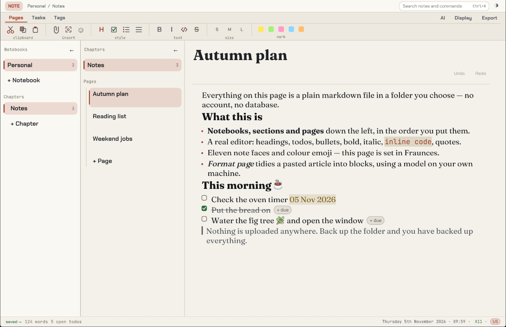

# NoteCraft

**Notes, todos and idea capture — fast, native, and yours.**

NoteCraft is a desktop notes app that keeps every page as a plain markdown file in a folder you
choose. Notebooks, sections, pages, a block editor with real formatting, eleven note faces, colour emoji,
todos with due dates, tags, images, screen snips, spellcheck and export — with no account, no
database and no lock-in. Point it at a model — a local Ollama, or any OpenAI-compatible server you
have a key for — and it will tidy a pasted article into blocks or summarise a page; without one,
that menu simply says so.

Built in Rust with [egui](https://github.com/emilk/egui), so it runs as one native window on
**Linux**, **macOS** and **Windows**.



## Download

| Platform | How |
| --- | --- |
| **Linux** (x86_64, aarch64) | `curl -fsSL https://raw.githubusercontent.com/mjb73/notecraft/main/install.sh \| sh` — or the `.deb` from [Releases](https://github.com/mjb73/notecraft/releases), or the tarball |
| **macOS** (Apple silicon, Intel) | `.dmg` from [Releases](https://github.com/mjb73/notecraft/releases) — drag NoteCraft to Applications |
| **Windows** (x64) | `.zip` from [Releases](https://github.com/mjb73/notecraft/releases) — unzip, run `notecraft.exe` |

Each download has a `.sha256` beside it.

The Linux binaries are built inside Debian 12 and need **glibc 2.35** — Ubuntu 22.04+, Debian 12+,
Mint 21+, Fedora 36+. (`readelf --version-info` on the download reports the exact floor, and the
`.deb` declares the same number.) On anything older, build from source: `cargo build --release`
links against whatever glibc you have.

**The builds are not code-signed by a commercial certificate.** That is what the extra click is
about:

- **macOS** — the app bundle is signed ad-hoc, so the first launch needs right-click → **Open**
  (or *System Settings → Privacy & Security → Open Anyway*). After that it starts normally.
- **Windows** — SmartScreen may say "Windows protected your PC": **More info → Run anyway**.
- **Linux** — nothing to do; `install.sh` puts the binary in `~/.local/bin` and the desktop entry
  in `~/.local/share/applications`, no root needed.

## Your notes

On first run NoteCraft creates `Documents/NoteCraft` (on every platform) and a **Welcome** page.
Pages are ordinary `.md` files:

```
Documents/NoteCraft/
  Personal/                        <- notebook
    Notes/                         <- section
      Welcome.md                   <- page, plain markdown
      Welcome.note                 <- the same page as a document (formatting, images, crops)
      assets/                      <- pictures and attachments, referenced from the page
  .trash/                          <- deleted pages, restorable in the app
```

Because it is a folder of files, backup, Dropbox/iCloud/Syncthing, `grep`, `git` and any other
editor already work on your notes. Nothing is uploaded anywhere; the app makes no network calls
unless you drag an image *URL* into a page, which downloads that image.

To use a different folder (an existing one, a synced one), set `NOTECRAFT_VAULT`:

```sh
NOTECRAFT_VAULT=~/Sync/Notes notecraft
```

## What it does

- **Notebooks → sections → pages**, with drag-free reordering, rename, duplicate, and a trash you
  can restore from.
- **A real editor** — headings, quotes, code blocks, todos, images, bold/italic/strikethrough/code
  on any range, text size, due dates, tags. Formatting lives in the `.note` document beside the
  page; the `.md` stays valid, readable markdown.
- **Read mode** that renders the markdown properly (`Ctrl+E`).
- **Tasks view** (`Ctrl+T`): every open checkbox in the vault, filtered by due/overdue/today/tag,
  tickable in place. Due dates (`@due(2026-10-24)`) show as chips.
- **Tags view**: a tag cloud over the whole vault, with counts.
- **One search** (`Ctrl+K` or `Ctrl+F`): pages, tags and commands in a single row, matching words
  highlighted. `F3` / `Shift+F3` step through the remaining matches in the open page, with a count
  in the status bar.
- **Pictures**: paste (`Ctrl+V`), attach files, drop them in, grab a screen snip (`Ctrl+Shift+S`)
  and crop it in the app, annotate it (`Ctrl+Shift+A`), resize it by dragging its corner, crop
  non-destructively (`Ctrl+Shift+C`), centre it, round its corners.
- **Note fonts and colour emoji.** The Display menu sets the note body in any of eleven bundled
  faces — Chakra Petch, Space Grotesk, Inter, Nunito, Fraunces, Literata, Merriweather, EB Garamond,
  Bitter, Caveat and Carlito — each name drawn in the face it names, with text size S/M/L. Colour
  emoji are painted from a Twemoji pack (egui's rasteriser cannot read a colour font), and the
  symbol picker only offers characters the bundled faces can actually draw.
- **Format and summarise with your own model** (optional): a pasted article becomes headings,
  bullets and paragraphs without the model retyping a word — it only says how to group the text —
  and any page can be summarised into a block. Point it at a local [Ollama](https://ollama.com),
  at ollama.com's hosted models, or at any OpenAI-compatible server (OpenAI, OpenRouter, Groq,
  DeepSeek, LM Studio, llama.cpp's server, vLLM…): *AI → Model settings*. Nothing is configured
  for you and nothing is sent anywhere until you name a server.
- **Spellcheck** with British and American dictionaries, per page.
- **Five themes** (`Ctrl+Shift+T`): Void, Ember, Slate, Paper, and **WordCraft** — Word's layout, done
  natively: three strips (title, menu line, command row), a contextual ribbon that changes with the
  tab, and the note drawn as a white page with Carlito type.
- **Export** to a self-contained HTML file, a PDF, plain text, or markdown to the clipboard.
- **A small CLI** for scripts and hotkeys (see below).

### Keyboard

`Ctrl` means `Ctrl` on Windows/Linux and either `Ctrl` or `⌘` on macOS.

| Shortcut | Action |
| --- | --- |
| `Ctrl+K` | command palette / search everything |
| `Ctrl+N` | new page in this section |
| `Ctrl+T` / `Ctrl+Shift+T` | tasks view / cycle theme |
| `Ctrl+E` | read mode ⇄ edit |
| `Ctrl+F` | search (the same box as `Ctrl+K`) |
| `F3` / `Shift+F3` | next / previous match in the open page |
| `Ctrl+S` | save now (it also autosaves) |
| `Ctrl+Z` / `Ctrl+Y` (or `Ctrl+Shift+Z`) | undo / redo |
| `Ctrl+1` / `Ctrl+2` | fold the notebook rail / the page list |
| `Ctrl+V` | paste an image or files from the clipboard |
| `Ctrl+Shift+V` | paste an image as a new block |
| `Ctrl+Shift+S` / `Ctrl+Shift+A` / `Ctrl+Shift+C` | snip the screen / annotate / crop a picture |

### Using your own model

*AI → Model settings…* is the whole of it: pick a **shape**, paste the **server**, name the
**model**, and give a **key** if the server wants one. *Test* asks the model one question before
you save, so a wrong address or a refused key says so in the dialog rather than in the middle of
formatting a page.

| Shape | Speaks | Start with |
| --- | --- | --- |
| **Ollama** | `POST {server}/api/chat` | `http://127.0.0.1:11434` + a model you have pulled (`ollama list`) |
| **OpenAI-compatible** | `POST {server}/v1/chat/completions` | `https://api.openai.com/v1`, `https://openrouter.ai/api/v1`, `http://localhost:1234/v1` (LM Studio), `http://localhost:8080` (llama.cpp) |

*Ollama cloud* is the Ollama shape pointed at `https://ollama.com` with an `ollama.com` key.
Anthropic and Google models are reachable through OpenRouter, or through their own
OpenAI-compatible endpoints. Anything `https://` is spoken directly — TLS with bundled roots, so
there is nothing to install.

The key is either typed into that dialog or, better, **named**: put `OPENROUTER_API_KEY` in the
"key from" field and the app reads the variable at each request, so no secret is written to disk.
A key typed in is stored in `ai.json` beside `state.json` (`~/.config/notecraft/` on Linux,
`~/Library/Application Support/notecraft/` on macOS, `%APPDATA%\notecraft\` on Windows) with mode
`0600` and never in the notes folder.

```
notecraft ai-test     # ask the configured model one question and print its answer
notecraft ai-setup    # open the window with Model settings already up
```

Nothing here is required: with no server configured the AI menu simply says so, and the rest of
the app is unaffected.

### Command line

```sh
notecraft                      # open the window
notecraft new "buy milk"       # append to today's Inbox, print the file
notecraft tasks                # open todos, one per line (due date first)
notecraft search "invoice"     # pages matching, with a snippet
notecraft path                 # print the vault folder
notecraft docs-migrate         # convert old pages to the document format
notecraft doc-sync Page.md     # rebuild one page's .note from its markdown (for scripts/phones)
notecraft --version
```

Flags: `--software` (render on the CPU, for machines with GPU driver trouble), `--x11` /
`--wayland` (Linux only), `NOTECRAFT_VAULT`, `NOTECRAFT_BACKEND`, `NOTECRAFT_SCREENSHOT_CMD`.

Only one window per vault can run at a time (an OS-held lock); a second launch says so. The CLI
verbs work while the window is open.

## Building from source

You need [Rust](https://rustup.rs) 1.90 or newer and, on Linux, a C toolchain and the usual X11 /
Wayland development packages. There is nothing else to install — fonts, icons and both spelling
dictionaries are compiled in.

```sh
git clone https://github.com/mjb73/notecraft
cd notecraft
cargo build --release          # target/release/notecraft
cargo test                     # 200 unit tests, no display needed
```

Install it where your desktop will find it:

```sh
# Linux, into ~/.local
install -Dm755 target/release/notecraft ~/.local/bin/notecraft
install -Dm644 packaging/linux/notecraft.desktop ~/.local/share/applications/notecraft.desktop
install -Dm644 assets/notecraft.svg ~/.local/share/icons/hicolor/scalable/apps/notecraft.svg

# Linux, a .deb (dpkg-deb or plain ar+tar; arch is amd64 or arm64)
packaging/linux/make-deb.sh target/release/notecraft 1.0.0 amd64 dist
# ...or, if you have cargo-deb, from `[package.metadata.deb]` in Cargo.toml
cargo install cargo-deb && cargo deb

# macOS: a real .app bundle (and a .dmg with the Applications shortcut, when hdiutil exists)
packaging/macos/make-app.sh target/release/notecraft 1.0.0 dist
```

`cargo install --path .` works too, but it skips the desktop entry and the icon.

## How it is put together

| File | What is in it |
| --- | --- |
| `src/vault.rs` | the vault on disk: three-level scan, front matter, tags, todos, atomic writes, `.trash` |
| `src/doc.rs` | a page as blocks and styled text runs; markdown ⇄ document |
| `src/app.rs` | the window: rail, page list, editor, tasks, tags, palette, overlays |
| `src/theme.rs` | the five themes, the font families, all drawing helpers |
| `src/platform.rs` | **everything that differs between the platforms**: file choosers, screen capture, opening a folder, the backend readout, the single-window lock |
| `src/emoji.rs` | colour emoji painted over the monochrome glyph cell, from `assets/emoji.pack` |
| `src/glyphs.rs` | the symbol and emoji catalogue, built from the bundled faces' own cmaps |
| `src/ai.rs` | the page formatter and the summariser: one HTTP call to the model the user configured — local Ollama, ollama.com, or any OpenAI-compatible server |
| `src/attach.rs`, `src/imgcache.rs`, `src/highlight.rs`, `src/spell.rs`, `src/export.rs` | attachments, image decoding cache, text layout, spelling, exports |
| `src/keylayout.rs`, `src/dragout.rs` | Linux extras: the KDE keyboard-layout chip, and dragging a picture out (X11 XDND) |

Platform differences are kept in `platform.rs` and in `cfg`-gated entry points, so the rest of the
code reads as if there were one platform. CI builds and tests on Linux, macOS (arm64) and Windows,
and `cargo check`s the Windows and macOS targets from Linux as well, so a `cfg` mistake is a build
failure rather than a broken download.

Two dependencies are pinned to a small local patch (`[patch.crates-io]` in `Cargo.toml`):

- `vendor/winit` — upstream's X11 drop target rejects `image/png`, which is what a browser drags, so
  dropping a picture from a browser into a page silently did nothing. Its XDND motion handler also
  drops the pointer position, which left a drop target sitting still while a file was moved about.
- `vendor/egui-winit` — a paste whose clipboard held only a picture emitted no event at all (the key
  press was swallowed in the same branch), so `Ctrl+V` looked like nothing had been pressed.

Only those DnD/clipboard branches are touched, and the winit file is not compiled on Windows or
macOS.

`assets/` carries the eleven note faces, their licence texts, the Twemoji pack (`emoji.pack`) and
the generated symbol catalogue (`glyphs.txt`) — around 11 MB, compiled in, so there is nothing to
install beside the binary.

## Known limitations

- **Linux + Wayland**: the toolkit (winit) has no drag-and-drop on Wayland, so dropping a file
  into the window does nothing there. Paste (`Ctrl+V`) and **Attach** work; launch with `--x11`
  (XWayland) if you want drag and drop. NoteCraft picks X11 automatically when an X server is
  reachable.
- **Dragging an image out of a browser works on Windows**, through the app's own OLE drop target
  (`src/windows_dnd.rs`): a browser offers a dragged picture as a *virtual file* or as raw PNG
  bytes, neither of which is the `CF_HDROP` the toolkit asks for, so NoteCraft registers a drop
  target that reads both. **On macOS it does not** — the toolkit only accepts real files there, so
  drag the picture to the desktop first, or right-click → **Copy image** and press `Ctrl+V`.
- **Dragging a picture out** of the window is an X11 feature (a hand-written XDND source). On
  Wayland, macOS and Windows, right-click the picture and copy it instead.
- **If a drop or a hotkey does nothing,** Windows writes what happened to
  `%APPDATA%\notecraft\dnd.log` (Linux: `~/.config/notecraft/dnd.log`). It names the formats the drag
  source offered, which is usually enough to tell a rejected drag from one that never arrived.
- **Format page / Summarise page** need a model you have pointed the app at (see *Using your own
  model*). With nothing configured the AI menu says so and nothing else changes. A model on your
  own machine keeps the words on it; a cloud endpoint sends the page's text to that provider,
  which the settings window says in as many words.
- **Colour emoji are painted pictures, not font glyphs**, because the toolkit's rasteriser reads
  outline fonts only. They scale with the note text but are not shaped by it (no colour-font
  ligatures), and a page exported to plain text carries the emoji character itself.
- **PDF export** needs one of WeasyPrint, wkhtmltopdf, or a Chromium-family browser (Microsoft Edge
  is on every Windows machine). The HTML export needs nothing and is the same page.
- **Unsigned builds** — see *Download* above.
- The interface is in English; there is no CJK font bundled, so Chinese/Japanese/Korean text falls
  back to whatever glyphs the system provides.

## Licence

MIT — see [LICENSE](LICENSE). The bundled fonts are under the SIL Open Font License and the emoji
pack is Twemoji under CC BY 4.0 (both in `assets/licenses/`), and the British/American word lists
are derived from public-domain sources (`assets/licenses/words.txt`).
